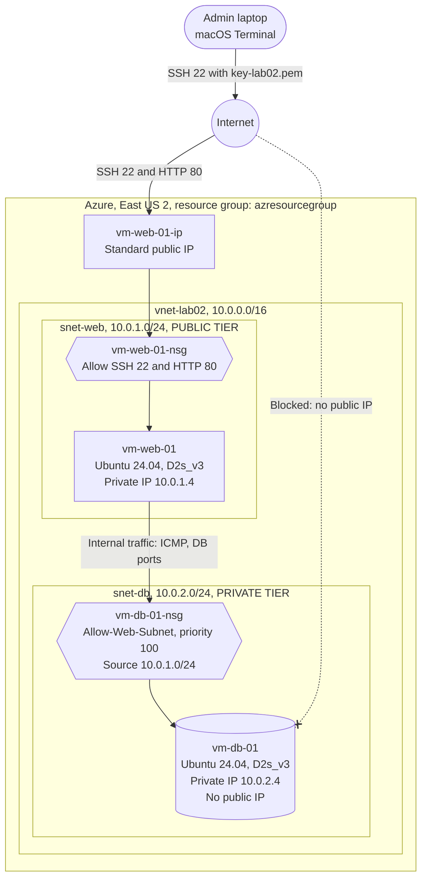
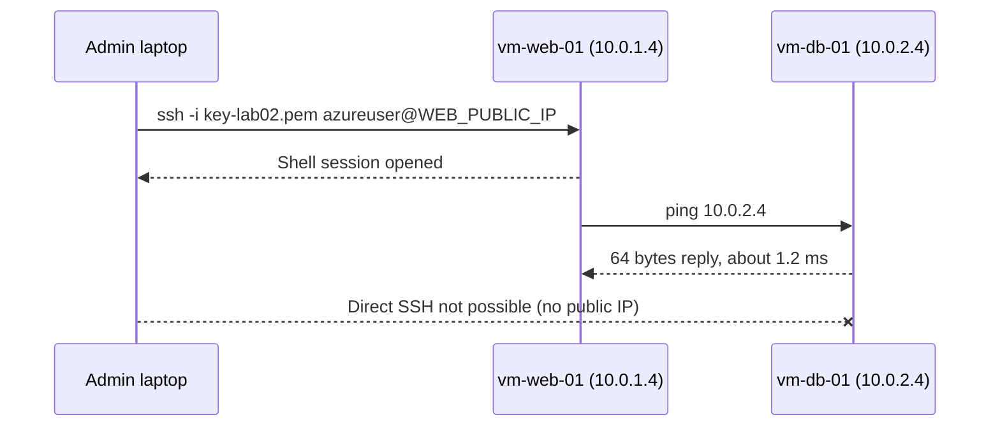

# Azure Lab 02: Secure 2-Tier Web Application (IaaS)


https://www.loom.com/share/4072403cf5934cff8c0c7edba63860ef 


A classic two-tier network on Azure: a **public web tier** that the internet can reach, and a **private database tier** that only the web tier can talk to. The lab practices network segmentation, Network Security Groups (NSGs), and the "jump host" pattern for reaching servers that have no public IP.

---

## Table of Contents

- [Objective](#objective)
- [Architecture](#architecture)
- [Environment and Naming](#environment-and-naming)
- [Build Guide](#build-guide)
- [Validation](#validation)
- [Issues Encountered and Fixes](#issues-encountered-and-fixes)
- [Security Review](#security-review)
- [Cost and Clean Up](#cost-and-clean-up)
- [Skills Demonstrated](#skills-demonstrated)

---

## Objective

1. Build a Virtual Network (VNet) with two subnets: one public, one private.
2. Deploy a web server into the public subnet with a public IP.
3. Deploy a database server into the private subnet with **no** public IP.
4. Prove the two servers can communicate inside the VNet.
5. Add an NSG rule that explicitly allows traffic into the database tier from the web subnet only.

---

## Architecture



**How to read it**

| Component | Role | Reachable from the internet? |
|---|---|---|
| `vnet-lab02` | Private network that holds both tiers | No |
| `snet-web` | Public tier ("front counter") | Yes, through the public IP |
| `snet-db` | Private tier ("back room") | **No** |
| `vm-web-01-nsg` | Firewall on the web server's network card | Allows 22 and 80 inbound |
| `vm-db-01-nsg` | Firewall on the DB server's network card | Allows traffic from `10.0.1.0/24` |

### Access path (the "jump")

The database server has no public IP, so it can only be reached by going through the web server first.



---

## Environment and Naming

The lab guide's defaults are on the left. The values actually used are on the right, with the reason for any change.

| Item | Lab guide | Used in this build | Why it changed |
|---|---|---|---|
| Region | East US | **East US 2** | East US returned errors on this subscription |
| Resource group | `rg-lab02-[name]` | `azresourcegroup` | Existing group reused |
| VNet | `vnet-lab02`, `10.0.0.0/16` | Same | |
| Public subnet | `snet-web`, `10.0.1.0/24` | Same | |
| Private subnet | `snet-db`, `10.0.2.0/24` | Same | |
| Image | Ubuntu Server 20.04 LTS | **Ubuntu Server 24.04 LTS (x64 Gen2)** | 20.04 is no longer offered |
| VM size | Standard_B1s | **Standard_D2s_v3** | B1s not deployable; another family had zero quota (see [Issues](#issues-encountered-and-fixes)) |
| Admin user | `azureuser` | Same | |
| SSH key | `key-lab02` | Same (RSA, generated by Azure) | |
| Web VM | `vm-web-01` | Same, private IP `10.0.1.4` | |
| DB VM | `vm-db-01` | Same, private IP `10.0.2.4` | |

> **Subscription:** Azure for Students

---

## Build Guide

Everything below is done in the [Azure portal](https://portal.azure.com). Keep every resource in the **same region** as the VNet, or the VMs will not be able to join it.

### Phase 1: Network foundation

1. Search **Virtual networks** and select **+ Create**.
2. **Basics:** choose the resource group, name `vnet-lab02`, region **East US 2**.
3. **Address space** tab:
   - Confirm the address space is `10.0.0.0/16`.
   - **Delete** the `default` subnet.
   - Add subnet `snet-web`, starting address `10.0.1.0`, size `/24`.
   - Add subnet `snet-db`, starting address `10.0.2.0`, size `/24`.
4. **Review + create**, then **Create**.

> Azure also creates a hidden `NetworkWatcherRG` resource group automatically. Leave it alone.

### Phase 2: Web server (public tier)

1. Search **Virtual machines**, then **+ Create > Virtual machine**.
2. **Basics:**
   - Name `vm-web-01`, region **East US 2**
   - Image **Ubuntu Server 24.04 LTS - x64 Gen2**
   - Size **Standard_D2s_v3** (see [Issues](#issues-encountered-and-fixes) if your preferred size is unavailable)
   - Authentication **SSH public key**, username `azureuser`, **Generate new key pair**, key name `key-lab02`
   - Public inbound ports: **Allow selected ports**, check **HTTP (80)** and **SSH (22)**
3. **Networking:**
   - Virtual network: **`vnet-lab02`** (the portal may pre-fill a brand-new VNet; change it)
   - Subnet: **`snet-web (10.0.1.0/24)`**
   - Public IP: **(new) vm-web-01-ip**
4. **Review + create.** Confirm the summary shows `HTTP (80), SSH (22)` and subnet `snet-web`.
5. **Create**, then **Download private key and create resource**. This is the only chance to download `key-lab02.pem`.
6. Note the VM's **public IP address** from its Overview page.

### Phase 3: Database server (private tier)

1. **+ Create > Virtual machine** again.
2. **Basics:**
   - Name `vm-db-01`, region **East US 2**, same image and size as the web VM
   - SSH public key source: **Use existing key stored in Azure**, select `key-lab02`
   - Public inbound ports: **Allow selected ports**, **SSH (22)** only
3. **Networking:**
   - Virtual network: **`vnet-lab02`**
   - Subnet: **`snet-db (10.0.2.0/24)`**
   - Public IP: **None**
   - NIC network security group: **Basic** (this creates `vm-db-01-nsg`, needed in Phase 5)
4. **Review + create.** Scroll to **Networking** and confirm: `vnet-lab02`, `snet-db`, Public IP `None`, NSG `vm-db-01-nsg`.
5. **Create.**

### Phase 4: Connect through the jump host

From a macOS or Linux terminal:

```bash
cd ~/Downloads
chmod 400 key-lab02.pem                          # SSH refuses keys that other users can read
ssh -i key-lab02.pem azureuser@<WEB_PUBLIC_IP>   # type "yes" at the fingerprint prompt
```

You are now on `vm-web-01`. Test the private tier:

```bash
ping 10.0.2.4     # Ctrl + C to stop
```

### Phase 5: Firewall rule on the private tier

1. Open **vm-db-01 > Networking (Network settings)**.
2. On the `vm-db-01-nsg` card, select **+ Create port rule > Inbound port rule**.
3. Enter:

| Field | Value |
|---|---|
| Source | IP Addresses |
| Source IP addresses/CIDR ranges | `10.0.1.0/24` |
| Source port ranges | `*` |
| Destination | Any |
| Service | Custom |
| Destination port ranges | `*` (or `3306` / `5432` once a real database is installed) |
| Protocol | Any |
| Action | Allow |
| Priority | `100` |
| Name | `Allow-Web-Subnet` |

4. **Add**, and confirm the rule appears at the top of the inbound list.

---

## Validation

| Test | Command / check | Expected | Result |
|---|---|---|---|
| SSH to web tier | `ssh -i key-lab02.pem azureuser@<WEB_PUBLIC_IP>` | Prompt shows `azureuser@vm-web-01` | Pass |
| Web to DB connectivity | `ping 10.0.2.4` from `vm-web-01` | Replies | Pass, 0% loss, about 1.2 ms |
| DB has no public exposure | vm-db-01 Overview | Public IP is empty | Pass |
| Web VM in correct subnet | NIC Overview, Virtual network/subnet | `vnet-lab02/snet-web`, `10.0.1.4` | Pass (after fix #5 below) |
| NSG rule present | vm-db-01-nsg inbound rules | `Allow-Web-Subnet`, priority 100 | Pass |

Sample output:

```text
azureuser@vm-web-01:~$ ping 10.0.2.4
PING 10.0.2.4 (10.0.2.4) 56(84) bytes of data.
64 bytes from 10.0.2.4: icmp_seq=1 ttl=64 time=1.24 ms
64 bytes from 10.0.2.4: icmp_seq=2 ttl=64 time=1.26 ms
64 bytes from 10.0.2.4: icmp_seq=3 ttl=64 time=1.18 ms
```

> **Tip:** Re-run the ping after Phase 5 to confirm the new rule did not break anything.

---

## Issues Encountered and Fixes

Real problems hit during the build, and how each was solved. This is the part most worth reading if you are repeating the lab on a student subscription.

| # | Symptom | Cause | Fix |
|---|---|---|---|
| 1 | Deployments failed in **East US** | Region restriction or capacity on the student subscription | Built everything in **East US 2** instead |
| 2 | **Ubuntu 20.04** not listed | Image retired from the marketplace | Used **Ubuntu 24.04 LTS** (no change to the lab steps) |
| 3 | **B1s** grayed out with "Find deployable options" | Size not available in that region for this subscription | Picked another size instead of switching regions (switching would have orphaned the VNet) |
| 4 | `QuotaExceeded` for `standardDalv6Family`, current limit **0** | Student subscriptions have zero quota on some VM families | Switched to **Standard_D2s_v3**, which had quota |
| 5 | Web VM got IP **10.0.0.4** instead of 10.0.1.x | The portal defaulted to a new VNet; after re-selecting `vnet-lab02`, the VM landed in an auto-created subnet `snet-eastus2-3 (10.0.0.0/24)` | Stopped (deallocated) the VM, opened its **NIC > IP configurations**, changed the subnet to `snet-web`, applied, restarted. New IP `10.0.1.4`; the Standard public IP was kept |
| 6 | DB VM review showed **NIC network security group: "-"** | Selecting Public IP `None` left the NSG unset | Set **NIC network security group** to **Basic** before creating |
| 7 | Review page showed only **SSH (22)** for the web VM | HTTP was not checked on the Basics tab | Went back to Basics and added **HTTP (80)** |

**Lessons learned**

- Always check the **Networking** section of the review page. The portal quietly pre-fills new VNets and subnets.
- Pick your region once and stay in it. A VM can only join a VNet in the same region.
- On student subscriptions, size availability and quota vary by region and VM family. Try a different size before trying a different region.
- Verify a VM's private IP against its subnet range. An address outside the expected range means it is in the wrong subnet.

---

## Security Review

### What protects the database tier today

1. **No public IP.** There is no inbound path from the internet to `vm-db-01` at all. This is the main control.
2. **Network segmentation.** Web and database workloads live in separate subnets with separate NSGs.
3. **Explicit allow rule.** `Allow-Web-Subnet` documents the intended trust: the web subnet may talk to the database tier.
4. **Key-based SSH.** No passwords; the private key is stored locally with `chmod 400`.

### Gaps worth knowing about

| Finding | Risk | Recommended hardening |
|---|---|---|
| Azure's default rule `AllowVnetInBound` (priority 65000) already allows **any** source in the VNet | `Allow-Web-Subnet` makes the intent explicit but does not by itself restrict other subnets | Add a lower-priority **deny** rule, e.g. priority 200, source `VirtualNetwork`, action Deny, so only `10.0.1.0/24` gets through |
| DB NSG rule `SSH` (priority 300) allows source **Any** | Harmless without a public IP, but too broad | Change its source to `10.0.1.0/24` |
| Web VM allows **SSH 22 from the whole internet** | Brute-force and scanning target | Restrict source to your own public IP, or use **Azure Bastion** / just-in-time VM access |
| Web VM allows **HTTP 80** with no web server installed | Open port with nothing behind it | Close until needed; use HTTPS (443) in production |
| Destination ports `*` on `Allow-Web-Subnet` | Broader than a database needs | Limit to the DB port (`3306` MySQL, `5432` PostgreSQL) |
| SSH from web to DB requires copying the `.pem` to the web VM | Private key stored on an internet-facing host | Use SSH agent forwarding (`ssh -A`) or `ssh -J` (ProxyJump) instead of copying keys |

> **Never commit `key-lab02.pem` to this repository.** Add `*.pem` to your `.gitignore`.

---

## Cost and Clean Up

| Resource | Approximate cost |
|---|---|
| 2 x Standard_D2s_v3 (running) | about $0.10 per hour each |
| 2 x OS disks | about $5 per month each, charged even when VMs are stopped |
| 1 x Standard public IP | about $3.65 per month |

**Pausing between sessions:** select both VMs and **Stop**. Wait until the status reads **Stopped (deallocated)**. Plain "Stopped" still bills for compute.

**Clean up when finished:**

1. Search **Resource groups** and open `azresourcegroup`.
2. **Delete resource group**, type the name to confirm, and **Delete**.

This removes the VMs, disks, NICs, NSGs, public IP, and VNet in one step.

---

## Skills Demonstrated

- Designing a VNet address space and subnetting with CIDR
- Deploying Linux VMs with SSH key authentication
- Building a public/private two-tier architecture
- Writing and reasoning about NSG rules and rule priority
- Using a jump host to reach private resources
- Troubleshooting region, SKU availability, and quota limits
- Re-homing a VM's network interface to a different subnet
- Cost control with deallocation and resource group cleanup

---

*Based on "Lab 02: Building a Secure 2-Tier Web Application" by Jhante Charles.*
